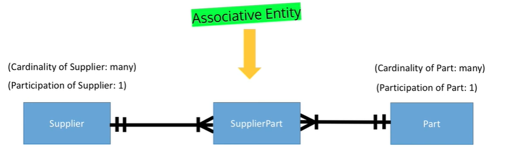

# **Data Modeling**

Data modeling is the practice of designing how data is structured and related, so it can be stored, understood, and analyzed consistently across an organization.

## Important Terminology

- **Entities :** Objects or concepts represented in the data, such as customer, products or orders.
- **Attributes :** Properties or characteristics of entities, like a customer's name, email...
- **Relationships :** Connections between entities, for example, a customer "places" an order
- **Business Rules :** Constraints and logic that govern how data is used and related

## Relational Database Basics

### Keys

- **Primary Key (PK) :** The column (or columns) that identifies exactly one row. It must be unique and never NULL, and a table has only one. Example: `orders.order_id`.
- **Composite Key :** A primary key made of more than one column, used when no single column is unique. Example: in `order_items`, `order_id` repeats (an order has several items), but the pair `(order_id, order_item_id)` is unique.
- **Candidate Key :** Any column set that *could* be the primary key: unique, never NULL, and minimal (remove any column and it stops being unique). A table can have several; you pick one as the primary key, and the others are called **alternate keys**. Example: a students table where both `student_id` and `email` are unique.
- **Foreign Key (FK) :** A column that holds another table's primary key. This is how a relationship is stored. Example: `order_items.order_id` → `orders.order_id`. A table can have several foreign keys (`order_items` also has `product_id` and `seller_id`).
- **Natural vs Surrogate Keys :** Covered in Week 1, item 8.

### Constraints

Constraints are rules the database enforces on every insert and update:

- **NOT NULL :** The column must always have a value.
- **UNIQUE :** No two rows can have the same value.
- **PRIMARY KEY :** UNIQUE + NOT NULL, once per table.
- **FOREIGN KEY (REFERENCES) :** The value must exist in the parent table. This is called **referential integrity**.
- **CHECK :** A custom rule, for example `CHECK (price >= 0)`.

**In cloud warehouses** (BigQuery, Snowflake, Databricks), primary and foreign keys are mostly **not enforced**: you can declare them, but they're informational. NOT NULL is enforced. That's why data engineers check keys themselves, with profiling and data tests.

### Data Types

| **Type** | **Use for** | **Olist example** | **BigQuery name** |
|-- | -- | -- | -- |
| **INTEGER / BIGINT** | Whole numbers, counts | `order_item_id`, `payment_installments` | INT64 |
| **DECIMAL(p, s)** | Exact numbers, **money** | `price`, `freight_value` | NUMERIC |
| **FLOAT / DOUBLE** | Approximate numbers, measurements | `geolocation_lat` | FLOAT64 |
| **VARCHAR / TEXT** | Text and text ids | `order_id`, `customer_city` | STRING |
| **DATE** | A calendar day | the date of an order | DATE |
| **TIMESTAMP** | A moment in time | `order_purchase_timestamp` | TIMESTAMP |
| **BOOLEAN** | True / false | an `is_current` flag | BOOL |

- **DECIMAL(p, s) :** `p` is the total number of digits and `s` the digits after the decimal point, so `DECIMAL(10, 2)` holds up to 99,999,999.99.
- **Why not FLOAT for money :** FLOAT stores approximations, so `0.1 + 0.2 = 0.3` is **false** with FLOAT and true with DECIMAL. Money totals would drift.

### Creating Tables (DDL)

The teacher/student example from the cardinality section, as a physical model:

```sql
CREATE TABLE teachers (
    teacher_id  INTEGER        PRIMARY KEY,
    name        VARCHAR(100)   NOT NULL,
    email       VARCHAR(255)   UNIQUE              -- candidate key
);

CREATE TABLE students (
    student_id  INTEGER        PRIMARY KEY,
    name        VARCHAR(100)   NOT NULL,
    teacher_id  INTEGER        NOT NULL REFERENCES teachers (teacher_id),  -- every student has exactly one teacher
    enrolled_on DATE,
    fees_paid   DECIMAL(10, 2) CHECK (fees_paid >= 0)
);

CREATE TABLE courses (
    course_id   INTEGER        PRIMARY KEY,
    title       VARCHAR(100)   NOT NULL
);

CREATE TABLE enrollments (                         -- associative entity: students ↔ courses (many-to-many)
    student_id  INTEGER        NOT NULL REFERENCES students (student_id),
    course_id   INTEGER        NOT NULL REFERENCES courses (course_id),
    enrolled_on DATE,
    PRIMARY KEY (student_id, course_id)            -- composite key
);
```

How the constraints carry the cardinality:

- **Foreign key + NOT NULL :** The child must have a parent (mandatory, minimum 1).
- **Foreign key without NOT NULL :** The child may have no parent (optional, minimum 0).
- **Foreign key + UNIQUE :** Each parent has at most one child (one-to-one).
- **"A parent must have at least one child" :** A simple constraint can't enforce this ("teachers must have at least one student"). It has to be checked by the application or by a test, like profiling check 2.

### Functional Dependency

**A → B** ("A determines B") means each value of A always comes with the same value of B.

- `order_id → order_status`: an order has one status. A primary key determines every column of its table.
- `product_id → product_category_name`: a product has one category.

Redundancy appears when a column depends on something other than the key. If `order_items` also stored `product_category_name`, the same category would repeat on every item of that product, and the copies could disagree. Normal forms are rules about which dependencies are allowed (Week 1, item 3).

## Phases In Data Modeling

- **Conceptual Data Model :** Highly abstract representation of entities and their relationships
- **Logical Data Model :** Detailed Representations of the data structure, including entities, attributes and relationships and their cardinality, independent of any specific database system
- **Physical Data Model :** Detailed blueprint of how data is stored in a specific database system

## Cardinality

Cardinality dictates how many of one entity can relate to another, and whether the relationship is optional. The relationships between entities can also be represented by functions

### Types Of Functions In Relationships

- **Injective Function :** Every member of set **a** has its own unique matching member in set **b**.
- **Surjective Function :** Every member of set **b** has at least one matching member in set **a**.
- **Bijective Function :** Injective + Surjective, so a true one to one relationship.

### Determining Cardinality

When determining the nature of a relationship we have to ask ourselves three important questions:

- **Degree :** How many sets (entities) are participating?
- **Participation :** What is the **minimum** number of relationships in which an entity can participate?
- **Cardinality Ratio :** What is the **maximum** number of relationships in which an entity can participate?

With these 3 questions answered, we can use crow's foot notation to represent the relationship between the entities.

#### Crow's Foot Notation


#### Example of determining cardinality based on a business requirement:

- **Requirement :** Every Student has exactly one teacher, and teachers can have many students, but must have at least one.

We first answer the Degree, Participation and Cardinality Ratio questions for both entities:

| **Entity** | **Degree** | **Participation** | **Cardinality Ratio** |  
|-- | -- | -- | -- |
| **Student** | 2 | 1 | 1 |
| **Teacher** | 2 | 1 | Many |

To define the relationship we look at the maximums, or cardinality ratio of each side, this example is defined as one-to-many, or many-to-one relationship.

And we use crow's notation to represent first the participation (inside) and then the cardinality ratio (outside) 

  

**Note :** Many to many relationships conceptually can be represented as:


But logically, in actual databases, many to many relationships are considered poor design and it's a huge resource drain in the database, because of this we would actually build an associative entity between them, its attributes being the primary keys for each entity they relate, like so: 



## ERD (Entity Relationship Diagrams)

ERDs are a visual way to express the **logical** design of a database.

## Data Profiling

Data modeling works in two directions:

- **Forward :** Requirements → conceptual → logical → physical. Used to design new models, like a warehouse star schema.
- **Backward (profiling) :** Start from data that already exists and find out what its model really is. Data engineers rarely create the source data; it comes from apps other teams built, and the documentation (if there is any) can be wrong. Only the data tells you the truth.

### Where It Fits In The Job

1. A new source arrives (a table, an API, a vendor file).
2. Profile it: row counts, keys, nulls, duplicates and cardinality.
3. Design the target model using what you found.
4. Turn the checks into automated tests that run on every load (in dbt: the `unique`, `not_null` and `relationships` tests).

### Counting Rows, Nulls And Duplicates

The three kinds of `COUNT` answer most profiling questions:

- **`COUNT(*)` :** Every row.
- **`COUNT(col)` :** Rows where `col` is **not NULL**.
- **`COUNT(DISTINCT col)` :** Different non-NULL values of `col`.

```sql
SELECT
    COUNT(*)                          AS n_rows,
    COUNT(*) - COUNT(col)             AS n_nulls,       -- missing values
    COUNT(DISTINCT col)               AS n_distinct,
    COUNT(col) - COUNT(DISTINCT col)  AS n_duplicates   -- extra copies of a value
FROM my_table;
```

If `n_nulls = 0` and `n_duplicates = 0`, the column could be a primary key.

### Why Cardinality Matters: Fan-Out

Joining a parent to two different "many" tables multiplies rows. Example: an order with 3 items that was paid in 2 payments gives 3 × 2 = 6 rows when you join order_items to payments, so summing revenue counts it several times. Know the cardinality before you join.

### Checking Cardinality With SQL

For a **parent** table (the "one" side, e.g. orders) and a **child** table that holds the foreign key (the "many" side, e.g. order_items):

- **Child maximum :** Always 1. A foreign key column holds one value, so a child points to at most one parent.
- **Everything else :** Comes from the data, with the queries below.

```sql
-- 0. Is the parent key really unique? (both numbers equal = unique)
SELECT COUNT(*) AS n_rows, COUNT(DISTINCT parent_id) AS n_keys
FROM parent;

-- 1. Parent maximum: the most children one parent has
SELECT parent_id, COUNT(*) AS n_children
FROM child
GROUP BY parent_id
ORDER BY n_children DESC
LIMIT 5;

-- 2. Parent minimum: parents with zero children
SELECT COUNT(*) AS parents_without_children
FROM parent AS p
LEFT JOIN child AS c ON c.parent_id = p.parent_id
WHERE c.parent_id IS NULL;

-- 3a. Child minimum: children with a NULL foreign key
SELECT COUNT(*) AS null_fks
FROM child
WHERE parent_id IS NULL;

-- 3b. Child minimum: orphans, foreign keys that match no parent (NULLs are counted here too)
SELECT COUNT(*) AS orphans
FROM child AS c
LEFT JOIN parent AS p ON p.parent_id = c.parent_id
WHERE p.parent_id IS NULL;
```

`LEFT JOIN ... WHERE right_side.key IS NULL` keeps only the rows with no match (an **anti-join**). It's the standard way to find the "zero" cases.

### Reading The Results As Crow's Foot

- **Parent maximum :** 1 → one; more than 1 → many.
- **Parent minimum :** 0 parents without children → mandatory (|); more than 0 → optional (O).
- **Child minimum :** 0 NULLs and 0 orphans → mandatory; more than 0 → optional, or a data quality problem to investigate.
- **Where to draw them :** The parent's numbers (how many children one parent has) go at the **child's** end of the line, and the child's numbers at the **parent's** end.

### Other Relationship Shapes

In a relational database, the only way two tables can be related is through a key column. So any relationship between two tables is one of these shapes:

| **Shape** | **Where the key lives** | **How to check it** |
|-- | -- | -- |
| **One-to-many** | A foreign key on the "many" side | The checks above, as written |
| **One-to-one** | A foreign key on either side (you choose) | The same checks; check 1 should show a maximum of 1 |
| **Many-to-many** | Neither table can hold it, so an **associative table** holds both keys | Run the checks twice, with each table as the parent and the associative table as the child |

#### Many-To-Many Example: Orders ↔ Products

In Olist, orders and products are related through `order_items`:

- Run the checks for orders → order_items, then again for products → order_items.
- For the "many" maximum, use `COUNT(DISTINCT ...)`: how many different products one order has, and how many different orders one product appears in.
- `DISTINCT` matters because Olist stores quantity as repeated rows: 7,088 order/product pairs appear more than once, so a plain `COUNT(*)` overstates it.

#### Trap: A Shared Column That Is A Key In Neither Table

`customers` and `geolocation` both have a zip code prefix, but neither table has one row per zip. Joining them on it turns 99,441 customers into 15,083,455 rows (a fan-out of about 150×).

The columns are `customer_zip_code_prefix` and `geolocation_zip_code_prefix` (the first 5 digits of a Brazilian postal code). The join matches every customer in a zip with every geolocation row for that zip. Example, zip `01012`:

- **customers :** 3 rows (3 customers live there).
- **geolocation :** 17 rows (17 GPS points inside that zip).
- **Join :** 3 × 17 = **51 rows** for 3 customers.

There's no error. The query runs, but counts and sums come out silently wrong.

#### Grain

The **grain** is what one row of a table represents.

- **customers :** One row per customer (`customer_id`).
- **geolocation :** One row per GPS point, **not** per zip (1,000,163 rows, but only 19,015 different zips).

To find it, guess ("one row per zip?") and test the guess with check 0. Grain is about **one** table and cardinality is about **two**, but the grain decides the cardinality: if the join column is unique in one table, the join is one-to-many and safe.

#### Checking A Join Step By Step

**1. Draw what you expect.** Use the business meaning. Example: `customer }|--|| location`, many customers live in one location.

**2. Check that the "one" side really is one.** Run check 0 on the parent's join column (here, the zip in geolocation). It fails: zip `01012` has 17 rows, not 1.

**3. If it isn't, ask whether it's really "many" in real life.**

| **Is it really many?** | **Then it's...** | **Fix** |
|-- | -- | -- |
| **Yes** | A true many-to-many. Example: students ↔ courses | An associative table (`enrollments`) |
| **No**, just repeats or measurements of the same thing | A grain problem | `GROUP BY` the table to the grain you need |

Geolocation is a **fake many**: one zip is one area, and the 17 rows are GPS points inside it. An associative table would keep all 17 links, so it would still give 51 rows. Collapse it instead:

```sql
CREATE TABLE geo_by_zip AS
SELECT geolocation_zip_code_prefix AS zip_code_prefix,
       AVG(geolocation_lat)        AS lat,
       AVG(geolocation_lng)        AS lng
FROM geolocation
GROUP BY geolocation_zip_code_prefix;
```

**4. Check again.** A fix you haven't checked is just a guess.

- **The "one" side is one now :** `geo_by_zip` has 19,015 rows and 19,015 different zips.
- **The join keeps the right row count :** `customers LEFT JOIN geo_by_zip` gives 99,441 rows, the same as `customers` alone.

#### Reading The Row Count After A Join

- **More rows than expected :** Fan-out. The "one" side isn't one.
- **Fewer rows than expected :** Rows were lost. An inner join drops children that have no match (the orphans from check 3b). Example: `customers JOIN geo_by_zip` gives 99,163 rows, because 278 customers have a zip that isn't in geolocation.
- **Same count :** The join is safe.

#### Rule Of Thumb Before Any Join

Run check 0 (key uniqueness) on the join column of **both** tables:

- **Unique on one side :** One-to-many; the unique side is the parent.
- **Unique on both sides :** One-to-one.
- **Unique on neither :** Many-to-many. Join through an associative table, or deduplicate or aggregate one side first.

## Resources
- [Database Cardinality Explained in 12 Minutes!](https://www.youtube.com/watch?v=PNCfDV2EL_o)
- [Entity Relationship Diagrams](https://www.youtube.com/watch?v=LowjDtiNlk4&t=1087s)
- [Entity Relationship Diagrams In Mermaid](https://mermaid.js.org/syntax/entityRelationshipDiagram.html)