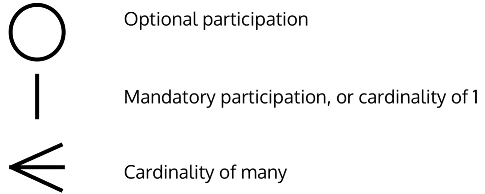
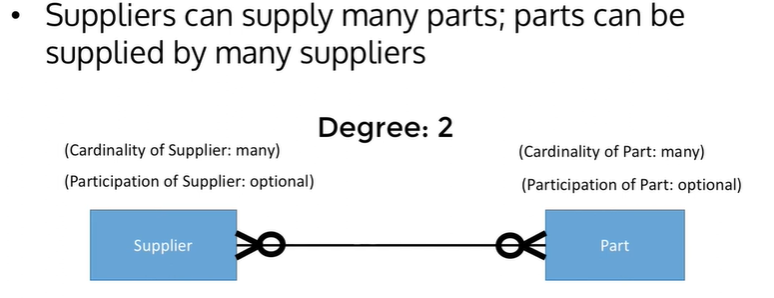

# **Data Modeling**

Data modeling is the practice of designing how data is structured and related, so it can be stored, understood, and analyzed consistently across an organization.

## Important Terminology

- **Entities :** Objects or concepts represented in the data, such as customers, products or orders.
- **Attributes :** Properties or characteristics of entities, like a customer's name, email...
- **Relationships :** Connections between entities, for example, a customer "places" an order.
- **Business Rules :** Constraints and logic that govern how data is used and related.

## Relational Database Basics

### Keys

- **Primary Key (PK) :** The column (or columns) that identifies exactly one row. It must be unique and never NULL, and a table has only one. Example: `orders.order_id`.
- **Composite Key :** A primary key made of more than one column, used when no single column is unique. Example: in `order_items`, `order_id` repeats (an order has several items), but the pair `(order_id, order_item_id)` is unique.
- **Candidate Key :** Any column set that *could* be the primary key: unique, never NULL, and minimal (remove any column and it stops being unique). A table can have several; you pick one as the primary key, and the others are called **alternate keys**. Example: a students table where both `student_id` and `email` are unique.
- **Foreign Key (FK) :** A column that holds another table's primary key. This is how a relationship is stored. Example: `order_items.order_id` → `orders.order_id`. A table can have several foreign keys (`order_items` also has `product_id` and `seller_id`).
- **Natural vs Surrogate Keys :** Covered in Week 1, item 8.

### Constraints

Constraints are rules the database enforces on every insert and update:

- **NOT NULL :** The column must always have a value.
- **UNIQUE :** No two rows can have the same value.
- **PRIMARY KEY :** UNIQUE + NOT NULL, once per table.
- **FOREIGN KEY (REFERENCES) :** The value must exist in the parent table. This is called **referential integrity**.
- **CHECK :** A custom rule, for example `CHECK (price >= 0)`.

**In cloud warehouses** (BigQuery, Snowflake, Databricks), primary and foreign keys are mostly **not enforced**: you can declare them, but they're informational. NOT NULL is enforced. That's why data engineers check keys themselves, with profiling and data tests.

### Data Types

| **Type** | **Use for** | **Olist example** | **BigQuery name** |
|-- | -- | -- | -- |
| **INTEGER / BIGINT** | Whole numbers, counts | `order_item_id`, `payment_installments` | INT64 |
| **DECIMAL(p, s)** | Exact numbers, **money** | `price`, `freight_value` | NUMERIC |
| **FLOAT / DOUBLE** | Approximate numbers, measurements | `geolocation_lat` | FLOAT64 |
| **VARCHAR / TEXT** | Text and text ids | `order_id`, `customer_city` | STRING |
| **DATE** | A calendar day | the date of an order | DATE |
| **TIMESTAMP** | A moment in time | `order_purchase_timestamp` | TIMESTAMP |
| **BOOLEAN** | True / false | an `is_current` flag | BOOL |

- **DECIMAL(p, s) :** `p` is the total number of digits and `s` the digits after the decimal point, so `DECIMAL(10, 2)` holds up to 99,999,999.99.
- **Why not FLOAT for money :** FLOAT stores approximations, so `0.1 + 0.2 = 0.3` is **false** with FLOAT and true with DECIMAL. Money totals would drift.

### Creating Tables (DDL)

```sql
-- Parent table
CREATE TABLE customers (
    customer_id   VARCHAR(32) PRIMARY KEY,
    customer_city VARCHAR(100)
);

-- Pattern 1: FK is just a reference; the table has its own PK
CREATE TABLE orders (
    order_id     VARCHAR(32) PRIMARY KEY,
    customer_id  VARCHAR(32) NOT NULL,
    order_status VARCHAR(20),
    FOREIGN KEY (customer_id) REFERENCES customers (customer_id)
);

-- Pattern 2: FK is part of a composite PK (one-to-many)
CREATE TABLE order_items (
    order_id      VARCHAR(32),
    order_item_id INT,
    price         DECIMAL(10,2),
    PRIMARY KEY (order_id, order_item_id),
    FOREIGN KEY (order_id) REFERENCES orders (order_id)
);

-- Pattern 3: FK is the entire PK (one-to-one)
CREATE TABLE customer_details (
    customer_id  VARCHAR(32),
    loyalty_tier VARCHAR(20),
    PRIMARY KEY (customer_id),
    FOREIGN KEY (customer_id) REFERENCES customers (customer_id)
);
```

### Functional Dependency

**A → B** ("A determines B") means each value of A always comes with the same value of B.

- `order_id → order_status`: an order has one status. A primary key determines every column of its table.
- `product_id → product_category_name`: a product has one category.

Redundancy appears when a column depends on something other than the key. If `order_items` also stored `product_category_name`, the same category would repeat on every item of that product, and the copies could disagree. Normal forms are rules about which dependencies are allowed (Week 1, item 3).

## Normalization

Structuring a database in such a way that it can't express redundant information, making the tables easy to understand, easier to enhance and extend, and protected from insertion, update and deletion anomalies.

### Attribute Dependencies

In **A → B**, A is the **determinant** and B the **dependent**. A **prime** attribute is part of a candidate key; a **non-prime** attribute isn't.

| **Dependency** | **Notation** | **Meaning** | **Example** | **Removed by** |
|-- | -- | -- | -- | -- |
| **Functional** | `A → B` | Each A has exactly one B | `order_id → order_status` | — |
| **Trivial** | `A → B`, B is part of A | Always true, says nothing new | `(order_id, order_item_id) → order_id` | — (always allowed) |
| **Full** | `(A, B) → C`, but neither A nor B alone → C | C needs the whole key | `(order_id, order_item_id) → price` | — (the goal) |
| **Partial** | `(A, B) → C`, and A → C | A non-prime column depends on part of a composite key | `order_id → order_status`, if `order_items` stored it | 2NF |
| **Transitive** | `A → B → C` | A non-prime column depends on the key through another non-prime column | `customer_id → zip_prefix → city` | 3NF |
| **Multivalued** | `A ↠ B` (or `A ->> B`) | Each A has a set of Bs, independent of the other columns | `employee ↠ skill` and `employee ↠ language` in one table | 4NF |
| **Join** | `*(R1, R2, R3)` | The table equals the join of 3+ of its smaller tables, but not of 2 | `(supplier, part, project)` rebuilt from its 3 pairs | 5NF |

### First Normal Form (1NF)

Rules:
- Using row order to convey information is not permitted
- All values in the column must be of the same data type
- All tables must have primary keys
- Repeating groups or multi-valued attributes are not permitted

### Second Normal Form (2NF)

Requires the table to be in 1NF and to have no partial dependencies, meaning every non-prime attribute must depend on the entire candidate key, not just part of it.

### Third Normal Form (3NF)

Requires the table to be in 2NF and contain no transitive dependencies, meaning every non-prime attribute must depend directly and only on a candidate key.

### Boyce-Codd Normal Form (BCNF)

A slightly stricter version of 3NF, sometimes called 3.5NF. Requires the table to be in 3NF, and the left side of every non-trivial dependency must be a **superkey** (a candidate key, or a column set that contains one).

- **3NF vs BCNF :** 3NF limits only **non-prime** attributes; BCNF applies to **every** attribute, including prime ones. Every BCNF table is in 3NF, but not the other way around.
- **When they differ :** Only when a prime attribute depends on something that isn't a key. That needs two overlapping composite candidate keys, so it's rare.
- **Example :** In `(student, course, teacher)`, each teacher teaches one course, so `teacher → course`. The candidate keys are `(student, course)` and `(student, teacher)`. It passes 3NF (every column is prime) but fails BCNF (`teacher` isn't a key), so a teacher's course repeats on every student row. Fix: split it into `(teacher, course)` and `(student, teacher)`.

### Fourth Normal Form (4NF)

Requires the table to be in BCNF and states that the only kinds of multivalued dependency allowed in a table are multivalued dependencies on the key.

### Fifth Normal Form (5NF)

Requires the table to be in 4NF and requires it to not be describable as the logical result of joining some other tables together.

## Deliberate Denormalization

Breaking normal forms **on purpose** so reads can skip joins: the same fact is stored in more than one place, or tables are pre-joined. "Deliberate" means you know which rule you break and why, and the copies are kept in sync, usually by a pipeline that rebuilds the table from the normalized source.

- **Why OLAP can afford it :** The pipeline is the only writer, so the update anomalies normalization protects against can't happen. And at warehouse scale, joins are the expensive part.
- **Columnar storage isn't denormalization :** It's how data is stored, not how tables are designed. But it removes most of the cost: repeated values compress well, and a query reads only the columns it uses.
- **OLTP does it too, in small doses :** Example: storing `order_total` on the order. The application keeps the copy in sync.

| **Technique** | **Olist example** | **Breaks** |
|-- | -- | -- |
| **Denormalized dimension** | `dim_product` holds the English category name | 3NF: `product_id → category → category_english` |
| **Wide table (One Big Table)** | `order_items` pre-joined with orders, customers and products | 2NF: `order_status` depends only on `order_id` |
| **Nested / repeated fields** | One row per order, with its items in an array (BigQuery's recommended way to denormalize) | 1NF: a repeating group |
| **Pre-aggregated table** | Daily revenue per category | Stores data that can be recalculated |

### The Grain Rule

Everything in a table must be at the table's grain, or aggregated to it before it's joined in. Example: payments are at the order grain, so joining them to an item-level wide table gives 3 items × 2 payments = 6 rows, and sums count twice.

- **Change the table's grain to the order :** Items have to be aggregated too, so questions by product or category are lost.
- **Aggregate payments to the order, then join :** The grain stays at the item, but `total_paid` repeats on every item of its order, so it can't be summed across rows.
- **One table per grain :** `fact_order_items` and `fact_orders`. This is the star schema answer.

### Star Schema

- **Fact table :** One row per business event at a declared grain, holding foreign keys and **measures** (the numbers you sum). Example: `fact_order_items`, with `price` and `freight_value`.
- **Dimension table :** The context of the event: who, what, where, when. Descriptive columns you filter and group by. Example: `dim_customer`, `dim_product`, `dim_seller`, `dim_date`.
- **Shape :** The fact in the centre, every dimension one join away. Dimensions are denormalized: `dim_product` holds the English category name, `dim_customer` holds city and state.

```
dim_customer ||--o{ fact_order_items
dim_product  ||--o{ fact_order_items
dim_seller   ||--o{ fact_order_items
dim_date     ||--o{ fact_order_items
```

### Snowflake Schema

A star schema whose dimensions are normalized into sub-dimensions, so the diagram branches out like a snowflake. Example: categories move out of `dim_product` into `dim_category`, and city and state move to a `dim_geography` by zip prefix, shared by customers and sellers (if `zip → city, state` holds, see Where Shared Attributes Live).

```
dim_category  ||--o{ dim_product
dim_product   ||--o{ fact_order_items
dim_geography ||--o{ dim_customer
dim_geography ||--o{ dim_seller
dim_customer  ||--o{ fact_order_items
dim_seller    ||--o{ fact_order_items
```

### Star vs Snowflake

| | **Star** | **Snowflake** |
|-- | -- | -- |
| **Dimensions** | Denormalized (break 3NF) | Normalized (usually 3NF) |
| **Joins per query** | One per dimension | More: dimension → sub-dimension |
| **Redundancy** | More, but cheap in columnar storage | Less |
| **SQL** | Simpler and faster | More joins, more complex |
| **Use when** | The default for analytics and BI | A sub-dimension is large or shared, like geography for customers and sellers |

The fact table is the same in both; only the dimensions change.

## Phases In Data Modeling

- **Conceptual Data Model :** Highly abstract representation of entities and their relationships
- **Logical Data Model :** Detailed representation of the data structure, including entities, attributes and relationships and their cardinality, independent of any specific database system
- **Physical Data Model :** Detailed blueprint of how data is stored in a specific database system

## Cardinality

Cardinality dictates how many of one entity can relate to another, and whether the relationship is optional. The relationships between entities can also be represented by functions.

### Types Of Functions In Relationships

- **Injective Function :** Every member of set **a** has its own unique matching member in set **b**.
- **Surjective Function :** Every member of set **b** has at least one matching member in set **a**.
- **Bijective Function :** Injective + Surjective, so a true one-to-one relationship.

### Determining Cardinality

When determining the nature of a relationship, we have to ask ourselves three important questions:

- **Degree :** How many sets (entities) are participating?
- **Participation :** What is the **minimum** number of relationships in which an entity can participate?
- **Cardinality Ratio :** What is the **maximum** number of relationships in which an entity can participate?

With these 3 questions answered, we can use crow's foot notation to represent the relationship between the entities.

#### Crow's Foot Notation



#### Example Of Determining Cardinality Based On A Business Requirement

- **Requirement :** Every student has exactly one teacher, and teachers can have many students, but must have at least one.

We first answer the Degree, Participation and Cardinality Ratio questions for both entities:

| **Entity** | **Degree** | **Participation** | **Cardinality Ratio** |  
|-- | -- | -- | -- |
| **Student** | 2 | 1 | 1 |
| **Teacher** | 2 | 1 | Many |

To define the relationship, we look at the maximums, or cardinality ratio, of each side. This example is defined as a one-to-many, or many-to-one, relationship.

And we use crow's foot notation to represent first the participation (inside) and then the cardinality ratio (outside).

  

**Note :** Many-to-many relationships conceptually can be represented as:



But logically, in actual databases, many-to-many relationships are considered poor design and they're a huge resource drain in the database. Because of this, we would actually build an associative entity between them, its attributes being the primary keys of each entity it relates, like so:


#### Junction vs Parent Tables

Not every many-to-many needs an associative table. First ask whether the many-to-many is **real** or **fake**.

| | **Junction table** (associative, bridge) | **Parent table** |
|-- | -- | -- |
| **Fixes** | A **real** many-to-many: both sides really are many in the business | A **fake** many-to-many: two tables share a value that is unique in neither |
| **One row is** | One pairing, a real business fact, often with its own columns | One value of the shared column, which becomes its primary key |
| **Position** | The child of both tables (the "many" side of both) | The parent of both tables (the "one" side of both) |
| **Crow's foot** | `A \|\|--o{ J }o--\|\| B` | `A }o--\|\| P \|\|--o{ B` |
| **Olist example** | `order_items` between orders and products: "this order has this product, at this price" | A zip prefix table between customers and sellers (see below) |

**The fake many-to-many in Olist :** customers and sellers both have a zip prefix, and it's unique in neither. Joined on it, zip `01123` gives 6 customers × 3 sellers = 18 rows, but no customer–seller pair is a real fact; they just share an area. A zip prefix table, with one row per zip, turns it into two honest one-to-many relationships: `customers }o--|| zip_prefix ||--o{ sellers`.

A parent table with only one child is the ordinary one-to-many. Example: `product_category_name_translation`. The category name is unique there (71 rows, 71 names), and many products point to one category.

**The test :** Can one row of the would-be junction record a real fact about one pairing?

- **Yes :** Junction table. "This order contains this product" is a real fact.
- **No :** Parent table. "Customer X is at GPS point Y" can't be known: a customer has a zip, not a point, so every row would be invented.

**Parent tables and 3NF :** Columns that depend on the shared value, not on the table's own key, move to the parent. Example: if `zip_prefix → city, state` holds, customers has `customer_id → zip_prefix → city, state`, a **transitive dependency**, so city and state belong in a zip prefix table. Test the dependency first (see Functional Dependency).

The source data often doesn't have the parent table yet. You build it, like `geo_by_zip` in "Checking A Join Step By Step", which collapses geolocation to one row per zip.

#### Connecting More Than Two Tables

Both fixes can connect any number of tables.

- **Parent tables :** A parent can have any number of children. In Olist, a zip prefix table would be the parent of customers, sellers **and** geolocation. Geolocation isn't the parent: it has many GPS points per zip, so it's a third child.

  ```
  customers   }o--|| zip_prefix
  sellers     }o--|| zip_prefix
  zip_prefix  ||--o{ geolocation
  ```

- **Junction tables :** A junction can link more than two entities. The number of entities in a relationship is its **degree** (see Determining Cardinality): 2 is **binary**, 3 is **ternary**. `order_items` is ternary: each row links an order, a product **and** a seller ("this order has this product, sold by this seller").

#### Where Shared Attributes Live: The Data Decides

Customers, sellers and geolocation all store city and state next to the zip. Whether they move to the zip prefix parent isn't a modeling choice: it depends on a fact in the data, so profile first and then design.

| **If profiling shows...** | **Then city and state depend on...** | **So they live in...** |
|-- | -- | -- |
| Every zip has exactly **one** city and state | The zip | The **parent**; remove them from all three children |
| Some zips have **several** cities (a zip spans a city border) | Something finer than the zip: the address or the point | The **children**; the parent doesn't hold them |
| *Almost* one, with a few exceptions | Decide whether the exceptions are real or dirty data | It depends on what you find |

**A parent connects, but it doesn't always locate :** A parent holding only the zip makes the joins safe, but `customer → zip_prefix → geolocation` still returns every GPS point in the zip (17 for zip `01012`), not one location.

- **The limit is the data :** Olist gives each customer's zip prefix, never their address. The most precise answer possible is "somewhere in zip `01012`". No model can create precision the source doesn't have.
- **To get one location per customer, reduce the points to one :** Average them into the zip's centre point, either at query time or by storing `avg_lat` and `avg_lng` in the parent (like `geo_by_zip`). One average per zip is always true, whatever the city/state test shows.
- **Resulting parent :** `zip_prefix` (PK), `avg_lat`, `avg_lng`, plus city and state only if `zip → city, state` holds.

## ERD (Entity Relationship Diagrams)

ERDs are a visual way to express the **logical** design of a database.

## Data Profiling

Data modeling works in two directions:

- **Forward :** Requirements → conceptual → logical → physical. Used to design new models, like a warehouse star schema.
- **Backward (profiling) :** Start from data that already exists and find out what its model really is. Data engineers rarely create the source data; it comes from apps other teams built, and the documentation (if there is any) can be wrong. Only the data tells you the truth.

### Where It Fits In The Job

1. A new source arrives (a table, an API, a vendor file).
2. Profile it: row counts, keys, nulls, duplicates and cardinality.
3. Design the target model using what you found.
4. Turn the checks into automated tests that run on every load (in dbt: the `unique`, `not_null` and `relationships` tests).

### Counting Rows, Nulls And Duplicates

The three kinds of `COUNT` answer most profiling questions:

- **`COUNT(*)` :** Every row.
- **`COUNT(col)` :** Rows where `col` is **not NULL**.
- **`COUNT(DISTINCT col)` :** Different non-NULL values of `col`.

```sql
SELECT
    COUNT(*)                          AS n_rows,
    COUNT(*) - COUNT(col)             AS n_nulls,       -- missing values
    COUNT(DISTINCT col)               AS n_distinct,
    COUNT(col) - COUNT(DISTINCT col)  AS n_duplicates   -- extra copies of a value
FROM my_table;
```

If `n_nulls = 0` and `n_duplicates = 0`, the column could be a primary key.

### Why Cardinality Matters: Fan-Out

Joining a parent to two different "many" tables multiplies rows. Example: an order with 3 items that was paid in 2 payments gives 3 × 2 = 6 rows when you join order_items to payments, so summing revenue counts it several times. Know the cardinality before you join.

### Checking Cardinality With SQL

For a **parent** table (the "one" side, e.g. orders) and a **child** table that holds the foreign key (the "many" side, e.g. order_items):

- **Child maximum :** Always 1. A foreign key column holds one value, so a child points to at most one parent.
- **Everything else :** Comes from the data, with the queries below.

```sql
-- 0. Is the parent key really unique? (both numbers equal = unique)
SELECT COUNT(*) AS n_rows, COUNT(DISTINCT parent_id) AS n_keys
FROM parent;

-- 1. Parent maximum: the most children one parent has
SELECT parent_id, COUNT(*) AS n_children
FROM child
GROUP BY parent_id
ORDER BY n_children DESC
LIMIT 5;

-- 2. Parent minimum: parents with zero children
SELECT COUNT(*) AS parents_without_children
FROM parent AS p
LEFT JOIN child AS c ON c.parent_id = p.parent_id
WHERE c.parent_id IS NULL;

-- 3a. Child minimum: children with a NULL foreign key
SELECT COUNT(*) AS null_fks
FROM child
WHERE parent_id IS NULL;

-- 3b. Child minimum: orphans, foreign keys that match no parent (NULLs are counted here too)
SELECT COUNT(*) AS orphans
FROM child AS c
LEFT JOIN parent AS p ON p.parent_id = c.parent_id
WHERE p.parent_id IS NULL;
```

`LEFT JOIN ... WHERE right_side.key IS NULL` keeps only the rows with no match (an **anti-join**). It's the standard way to find the "zero" cases.

### Reading The Results As Crow's Foot

- **Parent maximum :** 1 → one; more than 1 → many.
- **Parent minimum :** 0 parents without children → mandatory (|); more than 0 → optional (O).
- **Child minimum :** 0 NULLs and 0 orphans → mandatory; more than 0 → optional, or a data quality problem to investigate.
- **Where to draw them :** The parent's numbers (how many children one parent has) go at the **child's** end of the line, and the child's numbers at the **parent's** end.

### Other Relationship Shapes

In a relational database, the only way two tables can be related is through a key column. So any relationship between two tables is one of these shapes:

| **Shape** | **Where the key lives** | **How to check it** |
|-- | -- | -- |
| **One-to-many** | A foreign key on the "many" side | The checks above, as written |
| **One-to-one** | A foreign key on either side (you choose) | The same checks; check 1 should show a maximum of 1 |
| **Many-to-many** | Neither table can hold it, so an **associative table** holds both keys | Run the checks twice, with each table as the parent and the associative table as the child |

#### Many-To-Many Example: Orders ↔ Products

In Olist, orders and products are related through `order_items`:

- Run the checks for orders → order_items, then again for products → order_items.
- For the "many" maximum, use `COUNT(DISTINCT ...)`: how many different products one order has, and how many different orders one product appears in.
- `DISTINCT` matters because Olist stores quantity as repeated rows: 7,088 order/product pairs appear more than once, so a plain `COUNT(*)` overstates it.

#### Trap: A Shared Column That Is A Key In Neither Table

`customers` and `geolocation` both have a zip code prefix, but neither table has one row per zip. Joining them on it turns 99,441 customers into 15,083,455 rows (a fan-out of about 150×).

The columns are `customer_zip_code_prefix` and `geolocation_zip_code_prefix` (the first 5 digits of a Brazilian postal code). The join matches every customer in a zip with every geolocation row for that zip. Example, zip `01012`:

- **customers :** 3 rows (3 customers live there).
- **geolocation :** 17 rows (17 GPS points inside that zip).
- **Join :** 3 × 17 = **51 rows** for 3 customers.

There's no error. The query runs, but counts and sums come out silently wrong.

#### Grain

The **grain** is what one row of a table represents.

- **customers :** One row per customer (`customer_id`).
- **geolocation :** One row per GPS point, **not** per zip (1,000,163 rows, but only 19,015 different zips).

To find it, guess ("one row per zip?") and test the guess with check 0. Grain is about **one** table and cardinality is about **two**, but the grain decides the cardinality: if the join column is unique in one table, the join is one-to-many and safe.

#### Checking A Join Step By Step

**1. Draw what you expect.** Use the business meaning. Example: `customer }|--|| location`, many customers live in one location.

**2. Check that the "one" side really is one.** Run check 0 on the parent's join column (here, the zip in geolocation). It fails: zip `01012` has 17 rows, not 1.

**3. If it isn't, ask whether it's really "many" in real life.**

| **Is it really many?** | **Then it's...** | **Fix** |
|-- | -- | -- |
| **Yes** | A true many-to-many. Example: students ↔ courses | An associative table (`enrollments`) |
| **No**, just repeats or measurements of the same thing | A grain problem | `GROUP BY` the table to the grain you need |

Geolocation is a **fake many**: one zip is one area, and the 17 rows are GPS points inside it. An associative table would keep all 17 links, so it would still give 51 rows. Collapse it instead:

```sql
CREATE TABLE geo_by_zip AS
SELECT geolocation_zip_code_prefix AS zip_code_prefix,
       AVG(geolocation_lat)        AS lat,
       AVG(geolocation_lng)        AS lng
FROM geolocation
GROUP BY geolocation_zip_code_prefix;
```

**4. Check again.** A fix you haven't checked is just a guess.

- **The "one" side is one now :** `geo_by_zip` has 19,015 rows and 19,015 different zips.
- **The join keeps the right row count :** `customers LEFT JOIN geo_by_zip` gives 99,441 rows, the same as `customers` alone.

#### Reading The Row Count After A Join

- **More rows than expected :** Fan-out. The "one" side isn't one.
- **Fewer rows than expected :** Rows were lost. An inner join drops children that have no match (the orphans from check 3b). Example: `customers JOIN geo_by_zip` gives 99,163 rows, because 278 customers have a zip that isn't in geolocation.
- **Same count :** The join is safe.

#### Rule Of Thumb Before Any Join

Run check 0 (key uniqueness) on the join column of **both** tables:

- **Unique on one side :** One-to-many; the unique side is the parent.
- **Unique on both sides :** One-to-one.
- **Unique on neither :** Many-to-many. Join through an associative table, or deduplicate or aggregate one side first.

## OLAP vs OLTP

- **OLTP (Online Transaction Processing) :** Designed to handle large volumes of short, real-time transactions, such as payments, bookings and banking operations, using fast, ACID-compliant databases to ensure accuracy and consistency.
  - **Key Characteristics :**
     - **Row-based storage** optimized for reading and writing individual records
     - **ACID compliance** ensuring data integrity across concurrent transactions
     - **Normalized data models** that minimize redundancy
     - **Low latency**
     - **Real-time data freshness** used by applications and end users
- **OLAP (Online Analytical Processing) :** Enables fast, multidimensional analysis of large datasets to support business intelligence.
  - **Key Characteristics :**
     - **Columnar storage** optimized for aggregations and scans
     - **Read-heavy workloads**
     - **Denormalized or dimensional models (star or snowflake schema)** intentionally introducing redundancy for fast retrievals.
     - **Support for complex joins**
     - **Near-real-time to batch data freshness** used by data analysts and scientists.

Every modern organization uses the two different types of database workloads; in the real world, it's not a matter of choosing one, it's knowing when to use each.

### ACID

**ACID :** Atomicity, Consistency, Isolation, Durability.

- **Atomicity :** All or nothing; a transaction is accepted if everything that it needs to do happens.
- **Consistency :** All rules and constraints must be satisfied for data to be committed.
- **Isolation :** Transactions do not interfere with each other.
- **Durability :** Once a transaction is committed, its changes are permanent, even after crashes.

This is important because it ensures data integrity and protects from hardware failures, software bugs and concurrency issues.

## SQL Indexes

SQL indexes are special data structures that speed up data retrieval by letting the database jump directly to matching rows instead of scanning the entire table, improving query performance.

### Main Types Of SQL Indexes

- **Clustered Indexes :** Implements a B-tree structure, with a root node at the top, connected to an intermediate level or levels, and data pages or leaf nodes. Each of these nodes contains index rows, and the B-tree has a series of pointers that help the query engine jump and directly find the matching rows. Primary keys are by default clustered indexes.
- **Nonclustered Indexes :** Instead of index rows, the root node and intermediate level or levels contain key values, and the data pages or leaf nodes contain row locators, usually a table with `<Nonclustered Index>` and `<Clustered Index>`, so behind the scenes the query first looks at the tree to find the row locator and then looks at the clustered index tree with the locator.

#### Clustered And Nonclustered Index Basic SQL Creation Statement Syntax (SQL Server)

```sql
CREATE CLUSTERED INDEX IX_Table_Column
ON dbo.YourTable(YourColumn);


CREATE NONCLUSTERED INDEX index_name
ON table_name (column1 [ASC|DESC], column2 [ASC|DESC]);
```

**Note :** `CLUSTERED` / `NONCLUSTERED` and the `dbo.` schema are SQL Server syntax. DuckDB and PostgreSQL have no clustered indexes and use plain `CREATE INDEX`:

```sql
CREATE INDEX idx_orders_customer_id ON orders (customer_id);
```

### What Indexes Cost

- **Storage :** Every index is an extra structure with a copy of the indexed columns plus pointers, kept on disk and in memory.
- **Slower writes :** Every `INSERT`, `UPDATE` and `DELETE` must also update every index on the table. This is usually the bigger cost.

That's why write-heavy OLTP databases create only the indexes their key queries need (the same rule as in the MongoDB index notes).

### How OLAP Systems Do It Instead (BigQuery, Databricks)

A B-tree is built to jump to a few rows. OLAP queries scan and aggregate millions of rows, so warehouses and lakehouses mostly don't rely on B-tree indexes. Instead they cut down **how much data is read**:

- **Columnar storage :** Only the columns the query uses are read, and similar values in a column compress well.
- **Partitioning :** The table is split by a column (usually a date). A query that filters on that column skips whole partitions.
- **Clustering :** Data is sorted by chosen columns, and each block or file keeps metadata such as min/max values. A query that filters on those columns skips the blocks or files that can't match.

| | **BigQuery** | **Databricks (Delta Lake)** |
|-- | -- | -- |
| **Columnar storage** | Internal columnar format | Parquet files |
| **Partitioning** | Partitioned tables (by date, timestamp or integer range) | Supported, but liquid clustering replaces it for new tables |
| **Clustering** | Clustered tables: sorts storage blocks by up to 4 columns, then prunes blocks | Liquid clustering, recommended for all new tables |
| **Skipping** | Block pruning using block metadata | Data skipping using per-file min/max statistics, collected automatically on write |
| **Why it matters** | On-demand pricing charges for bytes scanned, so less data read = lower cost | Less data read = faster queries and less compute |

**Watch out :** BigQuery "clustering" (sorting storage blocks so they can be skipped) is a different thing from a **clustered index** (a B-tree whose leaf level holds the table's rows), despite the similar name.

## Resources
- [Database Cardinality Explained in 12 Minutes!](https://www.youtube.com/watch?v=PNCfDV2EL_o)
- [Entity Relationship Diagrams](https://www.youtube.com/watch?v=LowjDtiNlk4&t=1087s)
- [Entity Relationship Diagrams In Mermaid](https://mermaid.js.org/syntax/entityRelationshipDiagram.html)
- [What is the difference between OLTP and OLAP?](https://answers.databricks.com/oltp-vs-olap-differences-use-cases)
- [How do SQL Indexes Work](https://www.youtube.com/watch?v=YuRO9-rOgv4)
- [BigQuery: Introduction to clustered tables](https://cloud.google.com/bigquery/docs/clustered-tables)
- [Databricks: Use liquid clustering for tables](https://docs.databricks.com/gcp/en/delta/clustering)
- [Databricks: Data skipping](https://docs.databricks.com/gcp/en/delta/data-skipping)
- [Learn Database Normalization - 1NF, 2NF, 3NF, 4NF, 5NF](https://www.youtube.com/watch?v=GFQaEYEc8_8)