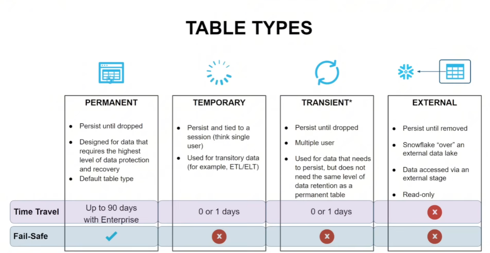
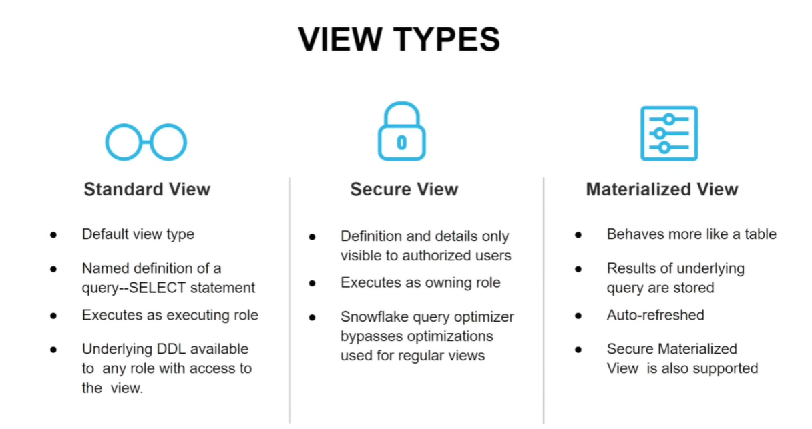
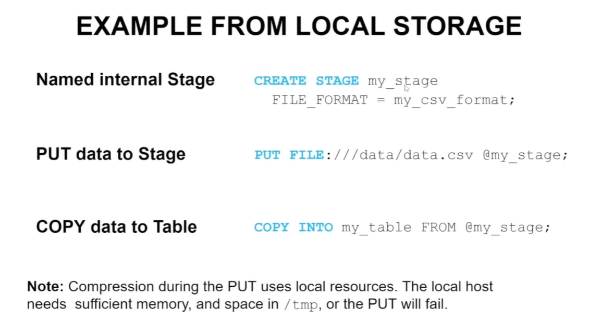
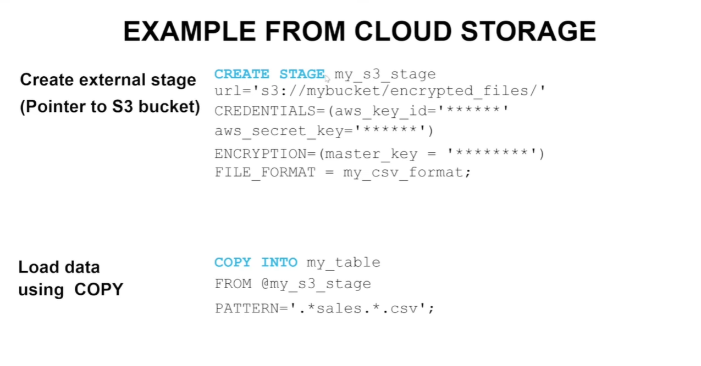
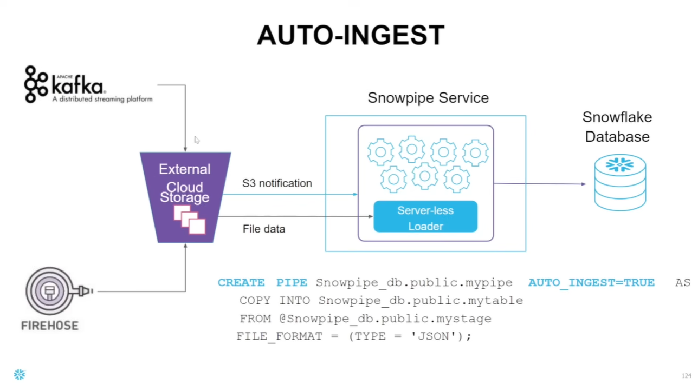
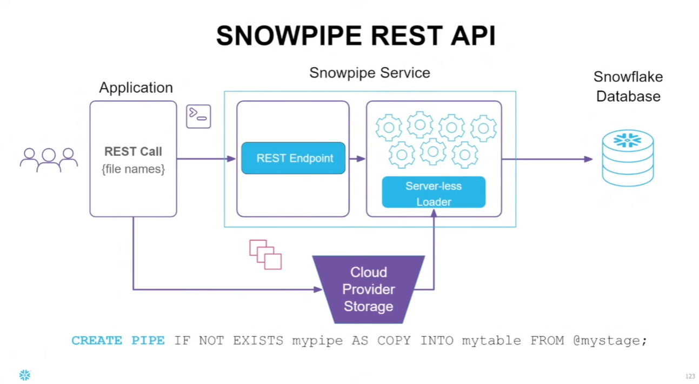
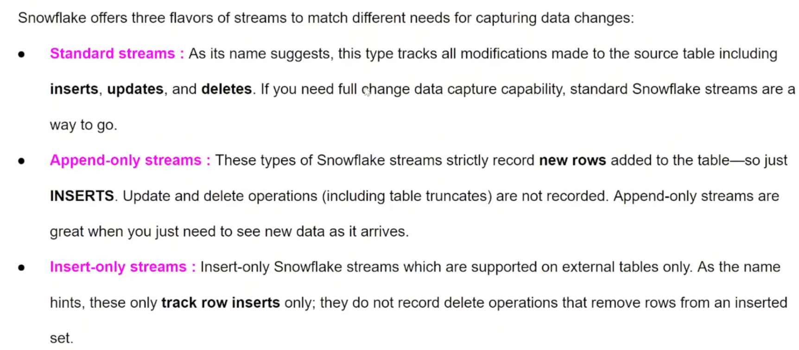
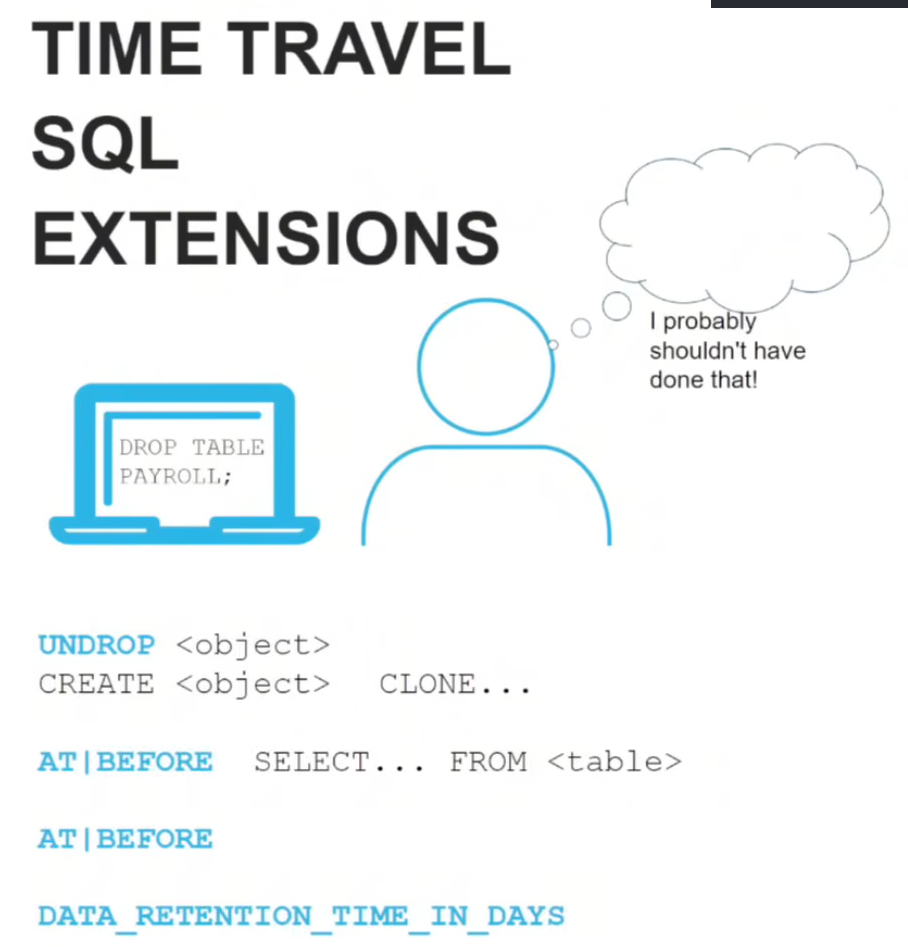
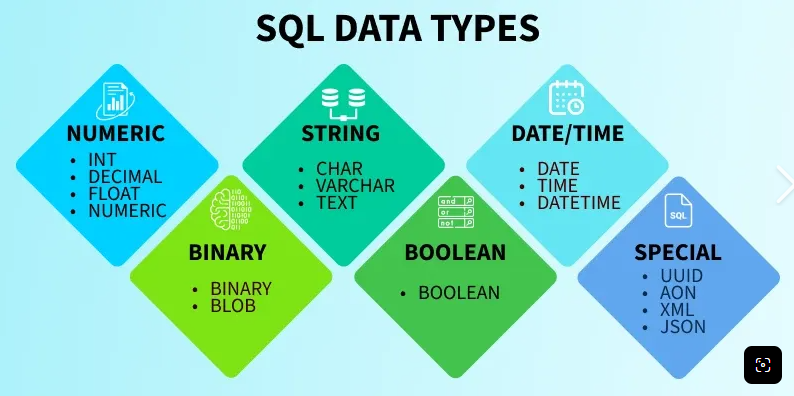

**Snowflake**

Snowflake is a cloud-based data platform delivered as a service, used for data warehousing, analytics and artificial intelligence workloads.

Snowflake can store any type of data structured, semi-structured and unstructured.

Micro partitions are **<u>immutable!</u>**

2 types of data warehouses available in snowflake, Standard, and (MCW) Mlti-Cluster Warehouse, the latter is capable of scaling.

At any time you can scale vertically or horizontally in snowflake, being a cloud based platform they have elasticity.

**Snowflake UI**

Usually in snowflake you can create or run processes via the UI or write a SQL query or DDL, or DDM operations

**Projects**, where you can store SQL queries, notebooks, dashboards or apps, in it you can create a SQL or Python worksheet too.

**Data**, here you can see all your database schemas or create a new database via UI.

**AI and ML**

**Monitoring**

**Admin,** related to account, you can check cost or credit usage, all data warehouses you have created, users and roles, security, etc…

**SQL in snowflake**

**DML:** Data Manipulation Language

**DDL:** Data Definition Language

**CRUD:** create, read, update and delete.

**ACID:** atomicity, consistency, isolation and durability.

**Data Warehouse:** Designed for business intelligence (BI) and reporting, data warehouses aggregate, clean, and structure data from multiple sources to provide a single source of truth for decision-making

**Data Lake**: Serves as a centralized repository for all types of raw data—structured, semi-structured, and unstructured

You can test SQL queries with other roles via or data warehouses via UI or SQL statements

You always need to have a role and warehouse to run the queries

CREATE OR REPLACE → can be used to create a database or schema with DATABASE or SCHEMA, schema needs the dbname, if a schema is not created or configured the schema will be the one that snowflake create as default.

**Tables**

In SQL:

CREATE OR REPLACE TABLE name

(

Column_name TYPE,

Column_name2 TYPE

);

CREATE OR REPLACE TEMPORARY TABLE name;

CREATE OR REPLACE TRANSCIENT TABLE name;

Time travel in image is retention, change retention:  
  
ALTER TABLE table_name SET DATA_RETENTION_TIME_IN_DAYS = number_of_days;

To check type of table and other table info use UI or:

SHOW TABLES;

Insert data to table, example:

INSERT INTO table_name (id_column, name_column, category_column, number_column)

VALUES (id_1, 'name_1', 'category_1', number_1),

(id_2, 'name_2', 'category_2', number_2),

(id_3, 'name_3', 'category_3', number_3);

**Views**

Database object that allows you to see the result of a query as if it was a table, when running a view for a standard or secure view, it compiles the data every time from the base table, materialized views stored the data into a cache.

Examples:

CREATE OR REPLACE VIEW view_name AS

SELECT id, name, salary

FROM table_name

WHERE department = ‘IT’;

CREATE OR REPLACE secure VIEW view_name AS

…;

CREATE OR REPLACE MATERIALIZED VIEW view \_name AS

…;

You can then SELECT from the view for example

**Stages**

Named storage location in snowflake where you can temporarily load or unload data files before transferring them. During ingestion workloads you need to create a stage object to manage it and they can be internal or external. Stages are useful to keep critical data safe, never double-load data, move huge amounts of data fast, centralize formatting rules with a “File Format” object, and filter, reorder or transform data during the exact moment it moves from the stage into the final table (no need to wait for load and then create table), they are created inside schemas and can also be created via UI.

COPY INTO table_name

FROM @stage_name

file_format = ();

command in SQL, which is Snowflake's optimized mechanism for ingesting or extracting massive datasets in parallel.

Types of stages in snowflake:

- Table Stage @%\[TABLE NAME\]:created automatically by snowflake when creating a table.

- User Stage @\~\[LOGIN\]:created automatically by snowflake when creating a user.

- Named Stage @\[STAGE NAME\]: unlike personal user or table specific stages, named stages can be accessed by multiple authorized users and leveraged to load data into several tables.

Types of named stages:

- Internal: physically store files in snowflake.

- External: stores pointers or passwords, so it can connect to where you have the files

External stages support: AWS, AZURE, GCP.

In SQL:

list @%\[TABLE NAME\];

CREATE OR REPLACE STAGE named_stage;

**File Format is snowflake**

Used when creating stages in UI or into COPY command

Supported files: CSV, JSON, AVRO, PARQUET, XML

You can then use the file format into various copy intos like:

CREATE OR REPLACEM FILE FORMAT file_format_name

Type = ‘CSV

FIELD DELIMETER = ‘,’

RECORD DELIMETER = ‘\n’

SKIP_HEADER = 1;

COPY INTO table_name

FROM @stage_name

FILE_FORMAT = (FORMAT_NAME= file_format_name)

**Snowflake Data Loading**

BULK

can be done from internal or external stages, done with COPY command

CREATE OR REPLACE STORAGE INTEGRATION storage_name; an account-level object in snowflake that creates a sort of trusted handshake between snowflake and your cloud provider

DESC INTEGRATION storage_name; describes integration, used to finish setup of trust policy between cloud providers and snowflake, and other things.

CREATE OR REPLACE STAGE stage_name

STORAGE_INTEGRATION = integration_name

URL = 's3://bucket_name/'

FILE_FORMAT = file_format_name;

CONTINUOUS

Done with Snowpipe, ingestion from modern data sources, continuous generated data is available for analysis in seconds, no need for auto-ingest schedules

To store unstructured data in snowflake you need to have a table with a column in data type VARIANT.

CREATE OR REPLACE PIPE pipe_name

AUTO_INGEST = TRUE

AS

COPY INTO table_name

FROM @stage_name

FILE_FORMAT = (FORMAT_NAME = file_format_name);

SELECT SYSTEM\$PIPE_STATUS('pipe_name'); can be paused and resumed

ALTER PIPE my_pipe SET PIPE_EXECUTION_PAUSED = true/false;

SHOW PIPES;

SELECT \* FROM table_name;

**Streams**

Streams. Objects that track all DML operations against the source tables, under the hood snowflake create three metadata columns (METADATA\$ACTION, METADATA\$UPDATE and METADATA\$ROW_ID) to the source table when created, these additional columns allow the stream to capture information about inserts, updates and deletes without having to store all the table data, streams can't be used in materialized views or secure objects.

- METADATA\$ACTION: Indicated the DML operation recorded.

- METADATA\$UPDATE: Tracks Updates as DELETE + INSERT pairs, (True or false).

- METADATA\$ROW_ID: Unique row identifier.

Types of streams:

CREATE OR REPLACE STREAM stream_name ON TABLE table_name;

CREATE OR REPLACE STREAM stream_name ON TABLE table_name APPEND_ONLY = TRUE;

CREATE OR REPLACE STREAM stream_name ON EXTERNAL TABLE table_name INSERT_ONLY = TRUE;

SELECT \* FROM stream_name;

Streams are used in ETLs

**Tasks**

Used to run SQL statements or stored procedures on a schedule, they can be created programmatically with SQL, the 4 most common parameters when creating it this way are:

- Schedule: when should the task be triggered

- Warehouse: what compute cluster should it use

- Code: the SQL command to run

- Condition: a boolean expression that gets evaluated when the Task is triggered.

Types of tasks

Server type:

- User-managed: created on a warehouse, fixed to the size of your assigned warehouse

<!-- -->

- Serverless: omit the warehouse parameter, Auto-scale dynamically

Schedule type:

- NON-CRON notation: SCHEDULE = ‘5 MINUTE”, runs every 5 minutes.

- CRON notation: ‘USING CRON \* 10 \*\* SUN UTC’, runs every single minute between 10:00 AM and 10:59 AM, every Sunday, in the UTC time zone

CREATE OR REPLACE TASK task_name

WAREHOUSE = COMPUTE_WH

SCHEDULE = ‘1 MINUTE’

AS…

The first time you create a task, as a default it will not be turned on you can see this with

SHOW TASKS;

SHOW TASK LIKE ‘task_name’;

DESCRIBE TASK task_name;

ALTER TASK task_name RESUME/SUSPEND;

Check status:  
  
SELECT \* FROM TABLE (information_schema.TASK HISTORY(TASK_NAME =\> ‘task_name’);

**Time Travel and fail safe**

**Time Travel**

Protects from user or system errors, with it you can access historical data at any point within a defined retention period and UNDO common mistakes.

You can query from a time travel with AT or BEFORE

SELECT \* FROM my_table

AT(TIMESTAMP/OFFSET =\>...);

SELECT \* FROM my_table

BEFORE(STATEMENT =\>’query id’); this can be checked in your query history

CREATE TABLE restored_table CLONE my_table

AT/BEFORE…

UNDO TABLE/SCHEMA/DATABASE

This works thanks to the micro-partition system of snowflake.

Fail-Safe then helps you access data from even before the max time-travel retention window, you have a period of 7 days for this and this is data you don’t have access to, only snowflake personnel.

**Cloning**

Effective backup or testing options, clones share the same micropartitions than the original object without any additional compute or storage until you make an update to it, creating a new micropartition for it.

**MongoDB**

Non relational database. Uses NoSQL which means not only SQL, for example a json or bson.

A lot of what you can do on mongodb can either be done via UI in Compass or programmatically.

**Modeling Data**

Start with conceptual data modeling, then move to logical data modeling, normalize the data, think about facts, events and actions, dimensions, and finish by physically modeling the data

Some data modeling techniques:

Normalization: removing redundancy and ensuring data integrity

- 1NF (First Normal Form): Each cell must hold one single, indivisible value. The table must have a primary key.

<!-- -->

- 2NF (Second Normal Form): Every column must depend on the entire primary key, not just a piece of a composite key.

<!-- -->

- 3NF (Third Normal Form): Every column must depend directly on the primary key, and never on another regular column.

<!-- -->

- BCNF (Boyce-Codd Normal Form): A stricter version of 3NF that cleans up rare edge cases with overlapping keys.

Dimensional Data Modeling (Star Schema / Kimball)

Divides data into facts and dimension tables, use primary and foreign ids, etc… , by doing this It restructures normalized data into a format that is easy for analysts to understand and fast for dashboards to query.

Data Vault

Data Vault is an advanced modeling technique designed for massive enterprise data

It splits data into three distinct table types:

Hubs: Core business keys (e.g., a Customer ID or Invoice Number).

Links: The relationships between Hubs (e.g., linking a Customer Hub to an Invoice Hub).

Satellites: The descriptive attributes and historical changes over time (e.g., the customer's name and address, and when it changed).

One Big Table (OBT)

Just what it sounds like

**Modeling data in MongoDB**

One main difference for mongodb is that in it we usually follow same basic concepts than relational databases, but we first identify workload and query patterns, and then design the data model to support it, \*data access together should be stored together\*

Thanks to the use of documents and their flexibility, we can create similar but different schemas for the same set of entities.h

Characteristics of schemas and databases in mongodb

- Polymorphism: ability to store documents with different structure within the same collection

- Arrays: field can now be arrays of multiple values

- Embedding: allows you to store documents within parent documents to represent relationships and hierarchies.

Normalizing data is still present in MongoDB, this is done via referencing other documents from a main document, you can even mimic a join operation with a \$lookup stage. You can choose to normalize some data, embed data, or use any combination of storage methods for your application.

For applications with a need for a more rigid schema for consistency, MongoDB also offers schema validation executed directly on the database.

**Indexes**

A performance-optimization technique that creates a special ordered data structure (Using a B-tree) to store a collection’s data. Indexes come with a cost, you should only create the minimum number of indexes needed to support our queries, this is done by first understanding our key queries and queries patterns. You can monitor slow queries in the mongodb query profiler, to see if a query may need a index.

Framework for indexes in MongoDB:  
  
- Identify queries for key workloads

\- Create the minimum number of indexes

\- Monitor and maintain indexes

**Compound Indexes**

Compound indexes are used for queries using 2 or more fields, and can reference up to 32 fields. When working with compound indexes we have to keep in mind ESR ordering, Equality field, followed by sort field and finally range filters.

**Aggregation Framework**

Aggregations are used for complex data processing or transformation.

\$match filters document to pass only those that match specify criteria

\$sort orders document in pipeline based on specified field or fields in ascending or descending order.

\$limit restricts number of documents passed

\$group combined documents into groups based on a key

\$lookup similar to a left outer SQL join

\$unwind deconstructs an array field, or flattens it

\$project reshapes the output

The order of stages is important, prioritize filtering and using indexes that can leverage indexes first, and if possible use \$project towards the end of a pipeline.

**MongoDB Data Hierarchy, Replication and Sharding**

MongoDB is a distributed system  
  
Document: group of field value pairs to represent an object

Collection: group of documents

Database: group of collections

Node: individual mongodb instance, in a physical machine, virtual machine or container

Cluster: group of nodes

Types of MongoDB Clusters

Replica Sets: help mongo db maintain high availability through replication, the process of storing multiple copies of data and keeping them synchronized in multiple nodes to provide redundancy

Sharded Clusters: this allows large data sets to handle massive amounts of data and scale horizontally, this is done by sharding, which is the process of distributing your data across multiple servers using shard keys, each shard operates as each own replica set.

Sharding requires careful planning, it adds complexity and is not always required

**MongoDB restore and Updates**

Backup is created using in the command prompt:

Mongodump - -db db_name - -out “path” created BSON file back up in a specified location

Mongoredtore Restore and insert the data back

For replica sets you use: mongodb - -oplog, to ensure that any data modified while the backup was running was also captured, and you create the backup from a secondary node

**MongoDB data types**

String: series of characters

Integers: Whole number

Doubles: floats in python

Booleans: true or false

Date Object: created with **new Date()**

Null: no value

Arrays: used for fields that can contain more than one value \[“value1”, “Value2”\]

Nested Documents: document within a document

Can be used via executable, but I prefer to use it in vscode

**Important commands**

**General**

exit

Mongsh to establish a connection

cls to clear screen

**Database**

show dbs shows databases like in SQL

Use database_name can be used to change or create a database

db.createColleaction(“students”) used to create a collection in a database, needed to finish the creation of a database so it shows when the show command is run.

dn.dropDatabase() drops database

**Collection**

db.students this will make you work on that database and collection, if no collection is called like this, it will create it.

db.students.insertOne({name:”Spongebob”, age:30, gpa:3.2}) insert a document

db.students.find({query, query}, {projection:true/false}) lists all documents in the collection, query is like a where, project true or false of what fields you want returned from the result

db.students.insertMany(\[{},{},...\]) inter many documents

db.students.find().sort({field:1/-1}) sort1 ascending, -1 descending

db.students.find().limit() limit the amount of documents returned, can be combined with other methods

updateOne({filter}, {update})/ UpdateMany()

Update operator:

\$set: replaces field or creates it if not exist

\$unset: removes item

db.students.deleteOne({filter})/ deleteMany()

Comparison Operators:

\$ne no equal

\$eq equal

\$lt less than

\$lte less than or equal

\$gt greater than

\$gte greater than or equal

\$in in array

\$nin not in array

Logical Operators

\$and

\$or

\$nor

\$not

**Indexes**

Allows for quick lookup of a field, but takes up more memory and slows insert, update and remove operators, find makes a linear search, but with indexes you can speed the process

db.students.createIndex({field: 1}) create indexes to a specific field, for id an indexes is created automatically.

db.students.getIndexes() lists your indexes in the collection

db.students.deopIndex({“name of index”})

**Collections**

Show collections

db.createCollections(“collection_name”, {capped:true, size:1000000, max:100} creates a database with a maximum size of 10 Mb and 100 documents

Another argument can be {autoIndexId:true/flase}

**DBT**

Data build tool, used for modern data engineering ELT workflows in the transformation layer, it usually integrated with PySpark (official Python API for Apache Spark)

**Advanced SQL**

\* (ALL)

TRUNCATE empties table, delete, can remove specific rows, drop destroys the data and the table

If not selecting run all, to run SQL statements you have to select them first before running.

// comment in snowflake, - - comment in standard SQL

JOINS:

SELECT column1, column2…

FROM db1

\_\_\_\_\_\_\_ JOIN db2

ON db1.colums = db2.column

WHERE condition(s)

ORDER BY value

Types of joins

INNER Join: Inner returns only matching values in both tables

LEFT Join: returns all values from the left tables even if there are no matches on the right table

RIGHT join: returns all values from the right tables even if there are no matches on the right table

FULL join: returns connected rows & unconnected rows from both left & right tables

GROUP BY: shows me an aggregate value order by a specified column

HAVING: similar to a where clause, but used to filter on aggregations

ORDER BY: sort, can sort by several columns at the same time and be ASC or DESC

CAST: converts to a specified data type

COALSECE: returns the first column of data with a non-null value in the specified date.

[<u>SQL Cheat Sheet PDF</u>](https://www.dataquest.io/cheat-sheet/sql-cheat-sheet/)
