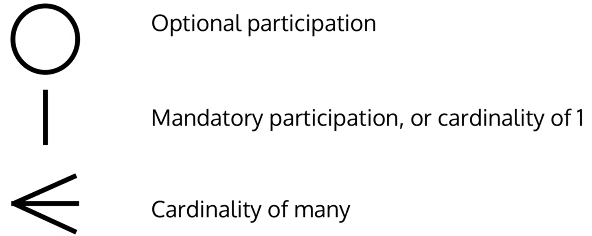
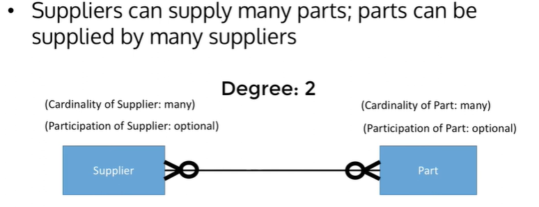
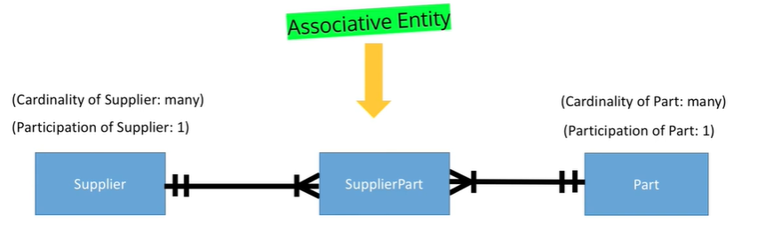

# **Data Modeling**

Data modeling is the practice of designing how data is structured and related, so it can be stored, understood, and analyzed consistently across an organization.

## Important Terminology

- **Entities :** Objects or concepts represnted in the data, such as customer, products or orders.
- **Attributes :** Properties or characteristics of entities, like a customer's name, email...
- **Relationships :** Connections between entities, for example, a customer "places" an order
- **Business Rules :** Constraints and logic that govern how data is used and related

## Phases In Data Modeling

- **Conceptual Data Model :** Higly abstract representation of entities and their relationships
- **Logical Data Model :** Datailed Represesntations of the data structure, including entities, atributes and relationships and its cardinality, independent of any specific database system
- **Physical Data Model :** Detailed blueprint of how data is stored in a specific database system

## Cardinality

Cardinality dictates how many of one entity can relate to another, and wheter the relationship is optional. the relationships between entities can also be represented by functions

### Types Of Functions In Relationships

- **Injective Function :** Every member of set **a** has its own unique matching member in set **b**.
- **Surjective Function :** Every member of set **b** has at least one matching member in set **a**.
- **bijective function :** Injective + Surjective, so a true one to one relationship.

### Determining Cardinality

when determining the nature of a relationship we have to ask ourselves three important questions:

- **Degree :** How many sets (entities) are participating?
- **Participation :** What is the **minimum** number of relationships in which an entity can participate?
- **Cardinality Ratio :** what is the **maximum** number of relationships in which an entity can participate?.

With this 3 questions answered, we can use crow's foot notation to represent the relationship between the entities.

#### Crow's Foot Notation

#### Example of determining cardinality based in business requirement:

- **Requirement :** Every Student has exactly one teacher, and teachers can have many students, but must have at least one.

We first answer the Degree, Paricipation and Cardinality Ratio questions for both entities:

| **Entity** | **Degree** | **Participation** | **Cardinality Ratio** |  
|-- | -- | -- | -- |
| **Student** | 2 | 1 | 1 |
| **Teacher** | 2 | 1 | Many |

To define the relationship we look at the maximums, or cardinality ratio of each side, this example is defined as one-to-many, or many-to-one relationship.

and we use crows notation to represent first the participation (inside) and then the cardinality ratio (outside) 

  

**Note :** many to many relationships conceptually can be represented as:

but logically, in actual databases, many to many relationships is considered poor design and its a huge resource drain in the database, because of this we would actually build a associative entity between them, its atributes being the primary keys for each entity they relate, like so: 

